# SentinelOps AI
### Autonomous Incident Investigation and Resolution Engineer

SentinelOps AI is an enterprise autonomous incident investigation and resolution operator for software engineering and SRE teams. It automates the end-to-end incident mitigation lifecycle through an explicit, closed-loop state machine:

```
GOAL → UNDERSTAND → PLAN → EXECUTE → OBSERVE → ADAPT → VERIFY → REPORT
```

Built with **Next.js 16**, **TypeScript**, **Tailwind CSS**, **Node.js/Express**, **SQLite**, **Playwright**, and **Groq SDK**, SentinelOps AI diagnoses root causes, executes registered tools under strict security policies, requests human authorization for restricted operations, and independently verifies outcome recovery using read-only API probes before generating grounded postmortem reports.

---

## 1. Architecture Overview

```mermaid
flowchart TD
    subgraph UI ["Frontend (Port 3000)"]
        DASH["Workflow Orchestration Dashboard"]
        GANTT["Execution Timeline Track"]
        APPR_MODAL["Human Approval Gate Modal"]
        ACT_MON["Real-Time Activity Monitor (SSE)"]
    end

    subgraph API ["SentinelOps API (Port 4000)"]
        ROUTES["Versioned Endpoints (/api/v1)"]
        SSE_BCAST["SSE Stream Broadcaster"]
    end

    subgraph CORE ["Agent Core Engine"]
        SM["Explicit State Machine (12 States)"]
        ORCH["Agent Orchestrator"]
        PLANNER["Structured Planner"]
        EXEC["Safe Executor"]
        OBS["Observation Loop"]
        RECOV["Adaptive Recovery Engine"]
        VERIF["Independent Verifier"]
    end

    subgraph LLM ["LLM Adapter"]
        GROQ["Groq SDK Adapter (llama-3.3-70b)"]
        DEMO["Deterministic Demo Planner"]
    end

    subgraph SEC ["Policy & Security Engine"]
        POL["Server-Enforced Policy Engine"]
        APPR_SRV["Cryptographic Approval Service (Single-Use Tokens)"]
        INJ_DEF["Prompt & Shell Injection Sanitizer"]
    end

    subgraph MEM ["Persistence Layer (SQLite WAL)"]
        DB[(sentinelops.db)]
        TSK["Task Store"]
        EVT["Event Store (Append-Only)"]
        EVI["Evidence Store"]
        CHK["Checkpoint Store"]
        RB_RET["Runbook Retriever"]
    end

    subgraph SIM ["Local Service Simulator (Port 5001)"]
        WORKER["Simulated Order Consumer Worker"]
        QUEUE["Queue Engine (order-events.v1)"]
        COUNTERS["Processing & Error Rate Counters"]
        CONSOLE["HTML Incident Console (Playwright Target)"]
    end

    DASH -->|POST /tasks| ROUTES
    DASH -->|SSE Stream| SSE_BCAST
    ROUTES --> ORCH
    ORCH --> SM
    ORCH --> PLANNER
    PLANNER --> GROQ
    PLANNER --> DEMO
    PLANNER --> RB_RET
    ORCH --> EXEC
    EXEC --> POL
    POL --> APPR_SRV
    EXEC --> SIM
    EXEC --> OBS
    OBS --> EVI
    ORCH --> RECOV
    ORCH --> VERIF
    VERIF -->|Read-Only Health & Queue Probes| SIM
    ORCH --> DB
    ORCH --> SSE_BCAST
    EXEC -->|Playwright Headless Browser| CONSOLE
```



---

## 2. Technology Choices & Rationale

| Layer | Technology | Rationale |
|---|---|---|
| **Frontend** | Next.js 16 (App Router), React 19, Tailwind CSS v4, Lucide Icons | High-density SaaS workflow dashboard matching enterprise orchestration design patterns with sub-second reactivity. |
| **Backend API** | Node.js v24, Express, TypeScript (ES Modules) | High-performance asynchronous API handling long-running task dispatches and Server-Sent Events. |
| **Database** | SQLite via built-in `node:sqlite` (WAL Mode) | Zero-compilation native synchronous SQLite on Windows/Linux; ACID transactions; parameterized queries. |
| **LLM Provider** | Official `groq-sdk` (`llama-3.3-70b-versatile`) | Ultra-fast inference (< 400ms token generation) for structured plan proposals. |
| **Fallback Engine**| Deterministic Demo Planner | 100% reproducible offline execution without API keys for demos, CI/CD, and regression testing. |
| **Browser Automation**| Playwright (Headless Chromium) | Automated visual inspection, DOM metric verification, and screenshot evidence capture of the service console. |
| **Testing** | Vitest (Unit/Integration) & Playwright Test (E2E) | Fast parallel test execution validating all state transitions, security bounds, and UI flows. |

---

## 3. Repository Structure

```
d:/founding2/
├── apps/
│   ├── web/                    # Next.js 16 Workflow Orchestration Dashboard (Port 3000)
│   │   └── src/
│   │       ├── app/            # App Router (page.tsx, layout.tsx, globals.css)
│   │       ├── components/     # Header, Sidebar, Timeline, TaskList, ApprovalModal, ReportModal
│   │       ├── hooks/          # useTaskStream (SSE live updates)
│   │       └── lib/            # api.ts client methods
│   ├── api/                    # Express API Server (Port 4000)
│   │   └── src/
│   │       ├── routes/         # Tasks, Approvals, Tools, Scenarios, Health
│   │       ├── sse/            # Server-Sent Events broadcaster
│   │       └── server.ts       # Main Express app
│   └── simulator/              # Stateful Service Simulator (Port 5001)
│       └── src/
│           ├── state.ts        # Dynamic order queue, worker tick loop, counters, logs
│           └── server.ts       # Simulator endpoints & /console HTML page
├── packages/
│   ├── shared/                 # Zod contracts, schemas, domain types, legal state transitions
│   ├── policy/                 # Policy engine, risk levels, human approval service
│   ├── memory/                 # SQLite stores (tasks, checkpoints, events, evidence, runbooks)
│   ├── tools/                  # 13 registered tools (diagnostics, remediation, Playwright capture)
│   ├── llm-groq/               # Groq SDK adapter, structured output parser, demo planner
│   └── agent-core/             # Orchestrator, state machine, executor, verifier, recovery engine
├── data/
│   ├── runbooks/               # RB-ORD-001, RB-WKR-002, RB-PAY-003
│   ├── policies/               # security-policy.json, approval-rules.json
│   ├── service-catalog.json    # Services, dependencies, SLO targets
│   └── incident-fixtures/      # Deterministic Scenarios A through G
├── tests/
│   ├── unit/                   # Policy, state machine, recovery engine tests
│   ├── integration/            # Simulator state, orchestrator scenarios, persistence
│   └── e2e/                    # Playwright browser dashboard tests
├── pnpm-workspace.yaml
├── tsconfig.base.json
├── vitest.config.ts
├── playwright.config.ts
└── README.md
```

---

## 4. Setup and Startup

### Prerequisites
- Node.js **>= 22.0.0** (Built-in `node:sqlite` required)
- pnpm **>= 9.0.0**

### Installation
```bash
# Clone the repository
cd d:/founding2

# Install dependencies across all monorepo workspaces
pnpm install

# Build all packages and applications
pnpm -r build
```

### Environment Configuration
Copy `.env.example` to `.env`:
```bash
cp .env.example .env
```
Default `.env` settings:
```ini
GROQ_API_KEY=                           # Optional: Leave empty for Deterministic Demo Mode
GROQ_MODEL=llama-3.3-70b-versatile     # Configurable Groq model
EXECUTION_MODE=demo                     # "demo" or "llm"
PORT=4000                              # SentinelOps API port
SIMULATOR_PORT=5001                    # Local Service Simulator port
WEB_PORT=3000                          # Frontend dashboard port
SIMULATOR_URL=http://localhost:5001
API_URL=http://localhost:4000
DATABASE_PATH=./data/sentinelops.db
```

### Starting the Applications
You can start all three services concurrently using root scripts:
```bash
# Start all 3 services (Simulator: 5001, API: 4000, Web: 3000)
pnpm dev
```
Or start each service individually:
```bash
# Terminal 1: Local Service Simulator
pnpm --filter @sentinelops/simulator dev

# Terminal 2: SentinelOps API Server
pnpm --filter @sentinelops/api dev

# Terminal 3: Next.js Frontend Dashboard
pnpm --filter @sentinelops/web start
```

### Service Endpoints
- **Frontend Dashboard:** [http://localhost:3000](http://localhost:3000)
- **Agent API Health:** [http://localhost:4000/api/v1/health](http://localhost:4000/api/v1/health)
- **Service Simulator Console:** [http://localhost:5001/console](http://localhost:5001/console)
- **Service Simulator Health:** [http://localhost:5001/health](http://localhost:5001/health)

---

## 5. Security & Human Approval Engine

SentinelOps AI implements a **server-enforced policy engine** that cannot be bypassed by frontend requests or LLM hallucinations:

1. **Risk Classification**:
   - `READ_ONLY`: Diagnostics (`get_service_health`, `get_queue_metrics`, `search_service_logs`, `inspect_worker_state`, `run_health_check`, `inspect_processing_counters`, `read_runbook`, `capture_console_evidence`). Proceed automatically.
   - `LOW_RISK_REMEDIATION`: Safe standard actions (`enable_simulated_worker`). Permitted automatically under seeded policy.
   - `RESTRICTED_REMEDIATION`: Consequential writes (`restart_simulated_worker`, `disable_simulated_worker`, `rollback_deployment`). **Execution immediately halts at `AWAITING_APPROVAL`.**
   - `FORBIDDEN`: Destructive operations (`purge_queue`, `drop_database_tables`, arbitrary shell execution). **Strictly blocked.**
2. **Cryptographic Single-Use Approval Tokens**:
   - Approval requests generate tokens bound to `{taskId, stepNumber, toolName, arguments}`.
   - Tokens have a default TTL of 300 seconds and are marked `CONSUMED` immediately upon execution.
   - Replay attacks, expired tokens, or mismatched task/tool tokens are rejected with `PolicyViolationError`.
3. **Untrusted Data Isolation**:
   - Log entries, runbook text, and external data are wrapped in `<untrusted_data>` blocks.
   - System instructions explicitly forbid interpreting text within these blocks as agent instructions.
   - Input argument sanitizer validates against command injection (`rm -rf`, `;`, `|`, `$(...)`).

---

## 6. Execution Loop & State Machine

SentinelOps AI implements an explicit 12-state state machine:

```
[CREATED] ──▶ [UNDERSTANDING] ──▶ [INVESTIGATING] ──▶ [PLANNING]
                                                          │
                    ┌─────────────────────────────────────┴──────────────────┐
                    ▼                                                        ▼
         [AWAITING_APPROVAL]                                            [EXECUTING]
                    │                                                        │
                    └──────────── (Token Approved) ──────────────────────────┤
                                                                             ▼
                                                                        [OBSERVING] ──▶ [RECOVERING]
                                                                             │               │
                                                                             ▼               ▼
                                                                        [VERIFYING] ◀────────┘
                                                                             │
                                                      ┌──────────────────────┴──────────────────────┐
                                                      ▼                                             ▼
                                                 [COMPLETED]                                     [FAILED]
```

---

## 7. Tool Registry

All operations are executed through strongly typed registered tools validated by Zod schemas:

| Tool Name | Risk Level | Description |
|---|---|---|
| `get_service_health` | `READ_ONLY` | Queries simulator `/health` endpoint for component status. |
| `get_queue_metrics` | `READ_ONLY` | Reads backlog depth, pending orders, and oldest job age. |
| `search_service_logs` | `READ_ONLY` | Filters logs by service name, severity (`ERROR`/`WARN`), and query keywords. |
| `get_recent_deployments` | `READ_ONLY` | Inspects recent container releases, commit SHAs, and deployers. |
| `read_runbook` | `READ_ONLY` | Retrieves SOP documentation (e.g. `order-processing.md`). |
| `inspect_worker_state` | `READ_ONLY` | Checks worker PID, thread count, and uptime. |
| `enable_simulated_worker` | `LOW_RISK_REMEDIATION` | Re-enables stopped consumer worker to resume order consumption. |
| `disable_simulated_worker`| `RESTRICTED_REMEDIATION` | Stops consumer worker (requires human approval). |
| `restart_simulated_worker`| `RESTRICTED_REMEDIATION` | Restarts consumer worker and resets locks (requires human approval). |
| `run_health_check` | `READ_ONLY` | Triggers active diagnostic probes across workers and databases. |
| `inspect_processing_counters`| `READ_ONLY` | Queries orders processed, failed orders, and error rate percentage. |
| `read_incident_state` | `READ_ONLY` | Reads active incident severity and alert metadata. |
| `capture_console_evidence`| `READ_ONLY` | **Playwright browser automation:** launches headless Chromium, navigates to `/console`, extracts live DOM metrics, and captures full-resolution base64 screenshots. |

---

## 8. Independent Verification Strategy

SentinelOps AI **never treats LLM claims or self-reported success as proof of recovery**. Verification is conducted by querying independent read-only APIs:

1. **Worker Process Running**: `inspect_worker_state` confirms `running === true` with a valid active PID.
2. **Service Health Probe**: `/health` returns HTTP 200 with `status: "HEALTHY"`.
3. **Queue Draining**: `get_queue_metrics` confirms `pendingCount < baselineCount`.
4. **Throughput Increment**: `inspect_processing_counters` confirms `processedCount > baselineCount`.
5. **SLO Error Threshold**: `errorRatePercent <= 5.0%`.

A task is marked `COMPLETED` **only** if all 5 criteria pass. If any probe fails, the system transitions to `RECOVERING` or `FAILED`.

---

## 9. Failure Recovery Scenarios

The simulator and agent support deterministic failure scenarios:

- **Scenario A: Worker Disabled (Standard Remediation)**
  - Worker is stopped; queue backlog accumulates.
  - Agent gathers diagnostics, consults RB-ORD-001, re-enables worker, verifies queue draining, and generates postmortem report.
- **Scenario B: First Remediation Attempt Fails**
  - Worker enable encounters simulated stale lock file `/var/run/order-worker.lock`.
  - Recovery engine classifies error as `LOCKFILE_CONFLICT`, detects orphaned process, performs cleanup, and succeeds on bounded retry.
- **Scenario C: Tool Timeout**
  - Diagnostic probe simulates a network timeout.
  - Recovery engine avoids blind retries; inspects current simulator state first before re-attempting.
- **Scenario D: Conflicting Evidence Reconciliation**
  - Shallow `/health` reports HTTP 200, but queue backlog is accumulating.
  - Agent gathers deeper evidence (logs and worker threads) to identify true root cause.
- **Scenario E: Restricted Action Approval Gate**
  - Worker restart is classified as `RESTRICTED_REMEDIATION`.
  - Runtime stops at `AWAITING_APPROVAL` with a pending token. Operator clicks "Approve" in the dashboard, and execution resumes to completion.
- **Scenario F: Runtime Restart & Checkpoint Resumption**
  - System restores persisted task state from SQLite checkpoints before executing non-idempotent writes.
- **Scenario G: Verification Failure Detection**
  - Worker restarted, but downstream database remains locked.
  - Verifier detects processed counters did not increase; task is correctly marked `FAILED` rather than falsely completed.

---

## 10. Test Commands & Actual Results

### Unit & Integration Tests (Vitest)
```bash
pnpm test
```
**Results:**
```
✓ tests/unit/policy.test.ts (9 tests)
✓ tests/unit/recovery.test.ts (4 tests)
✓ tests/unit/state-machine.test.ts (3 tests)
✓ tests/integration/simulator.test.ts (5 tests)
✓ tests/integration/persistence.test.ts (2 tests)
✓ tests/integration/orchestrator.test.ts (2 tests)

Test Files  6 passed (6)
Tests       25 passed (25)
Duration    10.97s (100% pass)
```

### End-to-End Tests (Playwright Test)
```bash
pnpm exec playwright test tests/e2e/dashboard.spec.ts
```
**Results:**
```
Running 3 tests using 1 worker

ok 1 Loads the incident command center dashboard with enterprise layout (793ms)
ok 2 Switches workflow tabs and displays content (958ms)
ok 3 Dispatches task via AI Operator interface and observes execution (4.4s)

3 passed (7.2s)
```

---
## 11. Production Roadmap & Limitations

### Current Proof-of-Concept Capabilities
- Local simulation environment with realistic order queues and stateful background ticks.
- 13 strongly typed registered tools with Zod input/output validation.
- Complete 12-state explicit state machine with legal transition enforcement.
- Server-enforced policy engine with single-use cryptographic approval tokens.
- Dual execution engine: Groq LLM mode and 100% reproducible Deterministic Demo mode.
- Playwright-driven browser automation for visual DOM inspection and screenshot capture.
- Server-Sent Events (SSE) live updates with automatic reconnect and event replay.

### Future Production Roadmap
- **Kubernetes Operator:** Deploy as an in-cluster Custom Resource Definition (`CRD`) with RBAC service accounts.
- **OpenTelemetry Integration:** Ingest OTLP traces and spans for distributed microservice causality graphs.
- **Slack / PagerDuty Integrations:** Bidirectional Slack interactive approval blocks and PagerDuty incident sync.
- **Vector Runbook Indexing:** Hybrid vector (HNSW) and BM25 search over enterprise Confluence/Notion wikis.
- **Multi-Tenant Authorization:** Role-based access control (RBAC) with Okta/SAML SSO and granular team boundaries.
